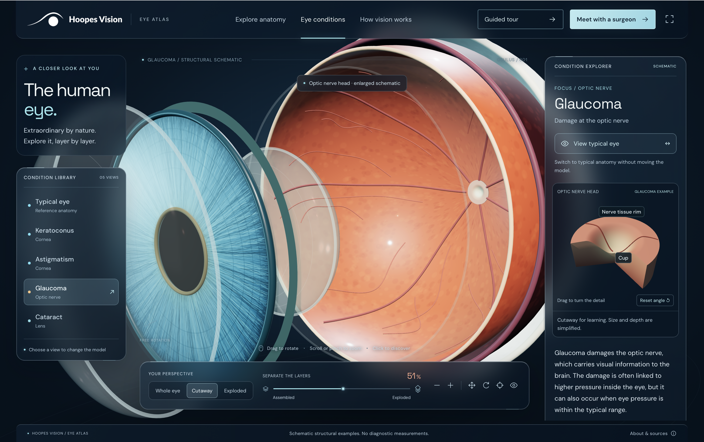
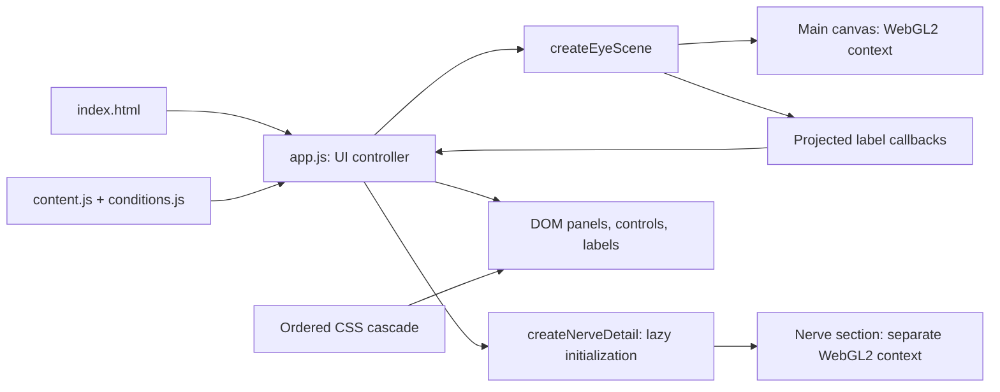

# Hoopes Vision Eye Atlas

A browser-based, procedural 3D eye explorer built with native JavaScript modules and Three.js. It supports anatomical selection, whole/cutaway/exploded views, condition-specific structural changes, typical-eye comparison, an illustrative light journey, and a separate interactive optic-nerve-head section.



*User-supplied screenshot of the glaucoma explorer with expanded anatomy. The image is stored in this repository.*

[Hosted preview](https://hoopes-vision-eye-atlas.joshchild.chatgpt.site/) · [Repository](https://github.com/HoopesIT/hvcc-eye-atlas)

## Quick start

```sh
gh repo clone HoopesIT/hvcc-eye-atlas
cd hvcc-eye-atlas
python3 -m http.server 4173 --directory dist
```

Open **http://localhost:4173/**. Keep the server running while developing; stop it with `Ctrl+C`. If GitHub CLI is unavailable, clone with Git:

```sh
git clone https://github.com/HoopesIT/hvcc-eye-atlas.git
cd hvcc-eye-atlas
python3 -m http.server 4173 --directory dist
```

GitHub access is required to clone a private repository. Once the files are local, the application has no account or server API requirement.

### Prerequisites and scripts

| Requirement | Purpose |
| --- | --- |
| Python 3 | The documented server uses standard-library `http.server`. Another static HTTP server can serve the app. |
| Modern browser with WebGL2 | Three.js r169 requires WebGL2. The app also uses native ES modules, Pointer Events, `ResizeObserver`, `requestAnimationFrame`, and `matchMedia`. |
| Node.js and npm, optional | Required for npm scripts and JavaScript syntax checks, not the deployed runtime. |

Setup and syntax checks were verified with Python **3.9.6** and Node.js **24.19.0**. These are verified versions, not declared minimum versions.

The repository requires no package installation or build. Serve `dist/` over HTTP or HTTPS. Opening `dist/index.html` through `file://` can fail because of browser ES-module origin restrictions.

```sh
npm start       # python3 -m http.server 4173 --directory dist
npm run check   # node --check on all five application modules
```

`npm start` still requires `python3` on `PATH`. To use another port, run the Python command directly with a different port number.

## Stack and source layout

| Layer | Implementation |
| --- | --- |
| Document and controls | HTML5, native buttons/range input, inline SVG symbol sprite, native `<dialog>` |
| Application logic | Browser JavaScript ES modules; `package.json` declares `"type": "module"` |
| 3D rendering | Vendored Three.js **r169 / 0.169.0**, imported from `dist/vendor/three.module.js` |
| Model generation | Procedural `BufferGeometry`, primitive meshes, curves, and Canvas2D-generated textures |
| Interface styling | Handwritten CSS, custom properties, media queries, and `backdrop-filter` |
| State | In-memory module variables, reset on page reload |
| Hosting | Static files; the existing Sites project publishes `dist/` |

The source contains no framework, bundler, package dependencies, application backend, database, application authentication, analytics integration, or service worker.

```text
.
├── README.md
├── package.json
├── .gitignore
├── .openai/
│   └── hosting.json          # Sites identity and static-directory setting
├── docs/
│   └── eye-atlas-preview.png # README image, outside the web root
└── dist/                    # Maintained source AND publish directory
    ├── index.html           # DOM, controls, dialog, SVG sprite
    ├── app.js               # State, events, mode transitions, content binding
    ├── content.js           # PARTS, VISION_STEPS, SOURCES, MODEL_NOTE
    ├── conditions.js        # Condition metadata, explanations, source links
    ├── eye-scene.js         # Main eye renderer and interaction controller
    ├── nerve-detail.js      # Independent glaucoma section renderer
    ├── styles.css           # Base interface and responsive rules
    ├── glass.css            # Glass materials, layering, layout overrides
    ├── conditions.css       # Condition panels and nerve-detail interface
    ├── favicon.svg
    ├── assets/hoopes-logo.png
    └── vendor/
        ├── three.module.js
        └── THREE-LICENSE.txt
```

**Edit `dist/` directly.** Despite its conventional name, it is not disposable build output. No build process recreates these files.

## Runtime architecture



### UI state and transitions

`app.js` owns `mode`, `view`, `selectedId`, `conditionId`, `comparing`, label visibility, pan/rotate mode, autorotation, and tour/journey indices. State is module-scoped, not attached to `window` or persisted across reloads. `PARTS` and `CONDITIONS` generate navigation buttons and provide the descriptions, source links, and target structures.

| Operation | Behavior |
| --- | --- |
| Enter conditions | Stop the tour and light paths; apply the retained condition, structure, view/separation preset, and `focusCondition()` framing. |
| Choose a condition | Reset comparison, apply its geometry/material targets, restore its preset, and reset article scroll. |
| Toggle typical eye | Retain the selected condition and current camera/separation; target reference geometry and update the UI and nerve section. |
| Leave conditions | Restore reference geometry immediately with `setCondition('normal', { animate: false })`. |
| Enter vision | Use reference anatomy, cutaway at 12% separation, and illustrative ray paths. |
| Start tour | Enter anatomy, use cutaway at 42%, and step through `PARTS`. |
| Reset in conditions | Keep the condition, exit comparison, and reapply its preset/framing. |
| Reset in vision | Return to anatomy and reset the view. |

The controller converts separation percentages to the renderer's normalized `0…1` range. Default separation is 0% for whole, 32% for cutaway, and 88% for exploded. Conditions and journeys can supply another value. `setView()` also sets target orientation; conditions call `focusCondition()` afterward to override framing.

### Main scene and coordinate system

`createEyeScene()` creates a Three.js scene, perspective camera, and transparent WebGL renderer:

- Camera: 34° vertical field of view, near `0.05`, far `80`.
- Renderer: antialiasing, alpha, high-performance preference, device-pixel ratio capped at `2`.
- Color pipeline: sRGB output, ACES filmic tone mapping, exposure `1.16`.
- Lighting: hemisphere, directional, and point lights. A generated reflection-card environment is processed once with `PMREMGenerator`.

The eye's axis is **X**: negative X is anterior, positive X is posterior. Y is vertical; Z is the other radial axis. Coordinates are arbitrary teaching-model units, not millimeters.

Nine anatomy groups are tracked in an `anatomy` map: cornea, iris, pupil, lens, vitreous, retina, choroid, sclera, and optic nerve. Indexed shell/band geometry creates the layers; rings/circles create the iris and pupil; a scaled sphere creates the lens; tubes follow optic-nerve and retinal-vessel curves. All geometry is generated locally. There is no imported glTF/GLB mesh or patient dataset.

Seeded Canvas2D code generates the iris texture at `1536 × 1536` and tissue maps at `1024 × 512`. Physical/standard/basic materials provide transmission, opacity, roughness, clearcoat, and surface lighting. Material IOR settings support the illustration; they do not make the light journey a refraction solver.

Exploded views animate X translations of anatomy groups. These offsets are explanatory spacing rather than physical movement. Whole-eye mode exposes anterior sclera and limbus; cutaway/exploded modes expose interior layers.

### Condition algorithms

`conditions.js` supplies metadata. `eye-scene.js` implements the actual model changes. A metadata row alone does not implement a new condition.

| ID | Implementation | Scope |
| --- | --- | --- |
| `normal` | Reference cornea, lens, and optic-disc geometry | Reference for this model |
| `keratoconus` | Corneal vertex X values receive an anterior Gaussian bulge near `y=-0.16, z=0.05`, tapered to zero at the circular limbus | Surface shape; corneal thickness is not modeled |
| `astigmatism` | Smooth corneal X deformation creates unequal perpendicular meridians while preserving the circular limbus | Corneal example, not lens astigmatism |
| `cataract` | Lens color, transmission, roughness, opacity, and clearcoat interpolate to a cloudy appearance | Lens opacity; no particle clusters or simulated patient vision |
| `glaucoma` | Native optic-disc cup widens/deepens within a fixed outer footprint, narrowing the surrounding rim; a separate section illustrates the recess | Selected structural example, without diagnostic ratios or severity scale |

For the cornea, let `q = min(1, (y² + z²) / 0.886²)`. The surface function is:

```text
x = -0.415 × sqrt(1 - q)
    - wKC × 0.48 × exp(-((y + 0.16)² + (z - 0.05)²) / 0.105) × (1 - q)^1.5
    - wAST × 0.14 × sqrt(1 - q) × (y² - z²) / 0.886²
```

`wKC` and `wAST` are transition weights. Both deformation terms vanish at the limbus. The corneal glint follows the surface. The earlier contour-line overlay has been removed; corneal topography is not currently displayed.

Cataract interpolation changes transmission `0.70 → 0.08`, roughness `0.055 → 0.43`, opacity `0.46 → 0.87`, and clearcoat `1.0 → 0.25`, with color moving toward `0xd7c99f`.

The native optic disc has radius `0.115`. Its illustrative cup radius changes `0.035 → 0.076` and depth `0.008 → 0.035`. Positive X recesses posteriorly. A small retinal opening prevents the shell from covering the cup.

Condition weights use `THREE.MathUtils.damp` with smoothing constant `7`, snapping to target within `0.0005`. Geometry updates recalculate normals and bounding spheres. Reference cornea restoration copies saved position and normal arrays to avoid accumulating deformation error. Comparison retains the condition ID while targeting all condition weights to zero.

### Independent glaucoma section

`nerve-detail.js` creates a second scene, camera, WebGL2 context, and render loop. The controller initializes it lazily on the first glaucoma selection and displays it in a framed panel.

The section is a thick procedural tissue block with a 120° front wedge removed. Its remaining 240° upper surface, cut faces, and outer wall expose the cup's depth. The surface has 48 radial and 112 angular steps; two surface-following vessels provide context.

Cup radius changes `0.29 → 0.67` and depth `0.18 → 0.49` inside a fixed outer radius of `1`. These are independent illustrative units, not a measured reconstruction of the native disc. Dedicated directional lighting, ordinary depth testing, and a `1024²` soft-shadow map make the recess legible. Rendering uses sRGB, ACES exposure `1.05`, and pixel-ratio cap `2`.

Comparison preserves camera distance and orientation. DOM labels project from anchors on the cup and retained rim. Rotation is constrained to azimuth `[-0.55, 0.80]` and polar angle `[0.58, 1.17]` radians. The detail's loop runs only while visible.

### Frame loop, picking, and cleanup

The main renderer continuously schedules `requestAnimationFrame`, capping frame delta at `0.05` seconds. Displayed separation, rotation, pan, zoom, and condition weights are damped toward their targets.

Custom Pointer Events implement interaction without `OrbitControls`. A click with little pointer movement raycasts registered meshes and calls `onSelect(id)`. Wheel/pinch zoom is clamped to `0.62…2.4`; vertical drag rotation and pan are also bounded.

Label anchors are projected into canvas pixels at most once every 32 ms. `app.js` filters them against HUD rectangles and other labels, allowing up to four on mobile and six on desktop. This is a screen-space heuristic, not full scene-depth occlusion. The native nerve-head label additionally checks surface facing and is hidden in whole-eye mode.

Both renderers expose `destroy()`: cancel animation frames, disconnect observers, remove listeners, dispose owned geometries/materials and renderer resources, and remove canvases. Main cleanup also disposes generated textures and the reflection environment. `app.js` invokes cleanup on `pagehide`. An embedding application must manage equivalent cleanup when unmounting these modules.

## Renderer interfaces

These calls describe the returned interfaces. `container` is a sized DOM element in a browser module. The application already imports and initializes both renderers; use these interfaces when embedding or extending them.

```js
const eye = createEyeScene(container, {
  onSelect(id) {},
  onReady() {},
  onLabelPositions(labels) {}, // [{ id, x, y, visible }]
});

eye.setView('whole');          // 'whole' | 'cutaway' | 'exploded'
eye.setExplode(0.32);          // normalized 0…1
eye.selectPart('cornea');      // known anatomy ID, or null
eye.setCondition('keratoconus', { animate: true, comparing: false });
eye.setComparison(true);
eye.focusCondition();
eye.setLabels(true);
eye.setAutoRotate(false);
eye.setLightPath(false);
eye.setInteractionMode('pan'); // 'rotate' | 'pan'
eye.pan(40, 0);                // screen-pixel deltas
eye.zoom(1);                  // exponential increment, not absolute zoom
eye.reset();
const state = eye.getState();
eye.destroy();
```

`setCondition()` returns `false` for unknown IDs. `{ animate: false }` applies condition weights immediately. `getState()` reports targets, which can differ from the current damped frame. `reset()` resets interaction/framing targets and autorotation; the controller separately coordinates condition, selection, view, and explosion.

```js
const detail = createNerveDetail(container);
detail.setVisible(true);
detail.setComparison(true); // true = reference, false = glaucoma example
detail.reset();             // angle reset, preserves comparison
detail.destroy();
```

## Glass, responsiveness, and accessibility

Preserve stylesheet order: **`styles.css → glass.css → conditions.css`**.

`#scene` spans the app at `z-index: 0`. The workspace is above it with `pointer-events: none`; HUD panels opt back in with `pointer-events: auto`. Semi-transparent backgrounds and `backdrop-filter: blur(24px) saturate(135%)` diffuse the actual eye beneath the panels. The transparent right-rail wrapper is intentional. An opaque parent or additional filtering surface can break the shared backdrop.

`styles.css` contains base rules followed by responsive/readability overrides. Inspect the final computed cascade before changing the first matching selector. Shared `--left-rail-edge` and `--left-rail-width` properties in `glass.css` align the intro and anatomy/condition menus.

Width breakpoints include 1600, 1370, 1100, 900, 760, and 360 px, plus short-height rules. Mobile lists scroll horizontally, controls compact, and condition mode uses a 1040 px minimum app height with an independently scrollable article. Both scenes resize with `ResizeObserver`.

| Input | Behavior |
| --- | --- |
| Drag main eye | Rotate |
| Shift-drag, or drag after **Move eye** | Pan |
| Wheel / two-pointer pinch | Zoom |
| Click pickable structure | Select |
| Arrows on focused **Move eye** button | Pan by 40 px and enable pan mode |
| `R`, `L`, `+`/`=`, `-` | Reset, toggle labels, zoom in/out |
| Drag nerve-section canvas | Rotate independent detail |
| Arrows / `Home` on nerve-section canvas | Rotate / reset its angle |

Global shortcuts are gated when an input/button/link has focus, the dialog is open, or Ctrl/Meta/Alt is held. The main globe does not implement keyboard arrow rotation. The nerve-section canvas is explicitly keyboard-focusable.

Native controls, `aria-pressed`, range value text, polite live descriptions, and visible focus styles support interaction. Main WebGL initialization failure retains the JavaScript-generated anatomy/text interface; the nerve section has its own text fallback. There is no no-JavaScript experience or formal accessibility certification in this repository.

Reduced motion disables autonomous rotation, bobbing, pulses, moving ray dots, and condition morph animation. Camera/separation damping and the main frame loop can remain active. Unsupported backdrop filtering and reduced-transparency preferences use more opaque backgrounds. Engines read motion preferences at initialization.

## Extending the application

### Conditions

1. Add metadata to `conditions.js`: `id`, `name`, `partId`, `subtitle`, `description`, `modelChange`, `caution`, `sourceUrls`, `preferredView`, and `preferredExplode`.
2. Add engine condition weight/ID handling, geometry or material changes, and reference restoration in `eye-scene.js`.
3. Add framing to `focusCondition()` and update the hardcoded model-note map in `app.js`.
4. Wire independent detail views through comparison, visibility, reset, and cleanup.
5. Verify that copy describes the visible changes and that leaving conditions restores reference anatomy before the light journey starts.

Keep `CONDITIONS[0]` as the reference entry: the controller uses its `modelChange` text during comparison.

### Anatomical structures

Update `PARTS`, engine anatomy groups/pickables, label anchors, selection radii/offsets, and the controller category map. Update hardcoded structure counts and tour text in `index.html` and `app.js`. IDs must agree across these locations.

Content is currently repository-controlled. Several templates use `innerHTML`; external user/CMS content would require sanitization or conversion to DOM APIs/`textContent`.

### Performance

- Profile transmission materials, texture generation, geometry updates, and backdrop blur on mobile hardware.
- The main loop does not currently pause on `visibilitychange`, render only dirty frames, use LOD, or adapt resolution beyond its pixel-ratio cap.
- Glaucoma can run two WebGL contexts. The detail pauses when hidden.
- Overlapping transparent meshes can exhibit view-dependent sorting artifacts.
- Dispose replaced vessel geometry and preserve existing texture/material ownership and cleanup patterns.

## Validation

```sh
npm run check
git diff --check
```

`check` runs `node --check` on `app.js`, `eye-scene.js`, `content.js`, `conditions.js`, and `nerve-detail.js`. It validates parsing only. There is currently no automated browser-test suite, geometry-test suite, or CI workflow. Syntax success does not establish rendering, clinical, or accessibility correctness.

For application changes, manually verify:

- Anatomy selection; all three views; separation; rotation, pan, zoom, labels, and reset.
- All four conditions and comparison toggles, including transitions into/out of vision mode.
- Nerve-section drag/keyboard controls, angle reset, fixed comparison scale, and hiding on another condition.
- Guided tour and the four-step light journey.
- Laptop, tall-desktop, and narrow-phone viewports: text, article scrolling, header/footer spacing, and overflow.
- WebGL2 failure messaging, reduced motion/transparency, keyboard focus, and console errors.

## Hosting, releases, and caching

The deployment unit is **`dist/`**. Configure a static host with no build command and `dist` as document root. Preserve relative paths and serve `.js` with a JavaScript MIME type. There is one HTML entry point and no client router, so a route-rewrite layer is unnecessary.

Core geometry, Three.js, logo, favicon, and UI files are local. `styles.css` loads DM Sans and Space Grotesk through Google Fonts; system fonts provide fallbacks. Source links and the consultation CTA navigate externally. The CTA links to `https://www.hoopesvision.com/`; it does not submit a booking or call a scheduling API.

The existing Sites binding is:

```json
{
  "project_id": "appgprj_6adada080f3881919d687ba18dc9f074",
  "static": { "directory": "dist" }
}
```

`.openai/hosting.json` is metadata, not a credential. GitHub pushes and Sites publication are separate operations. This repository has no standalone Sites deployment CLI or deployment workflow. Publishing through the Sites integration requires synchronizing the exact source commit, packaging its static assets, saving a version, and deploying that version to the existing project. Preserve its audience/access policy. Hosted access control belongs to Sites; copying the static files elsewhere does not transfer that policy.

Entry URLs currently use `?v=nerve-section-5`. `index.html` versions `app.js` and `conditions.css`; `app.js` versions the renderer, condition data, and nerve-detail imports. Update relevant parent and child URLs together on releases so browsers do not mix old markup/styles with new JavaScript. Changed unversioned resources need equivalent cache invalidation.

## Troubleshooting

| Symptom | Check |
| --- | --- |
| Blank page/module error after opening a file | Serve `dist` over HTTP instead of opening `index.html` directly. |
| `python3` not found with `npm start` | Use a Python 3 runtime or another static HTTP server. |
| `node`/`npm` not found | Python serving still works; a Node runtime is needed for syntax checks. |
| Address already in use | Stop the existing server or choose another port. |
| Eye unavailable but descriptions work | Check WebGL2, browser GPU/hardware acceleration, and console errors. |
| Module returned as HTML/wrong MIME type | Correct the document root and asset serving; remove HTML rewrites for `.js` requests. |
| Missing-element errors or stale styles after a release | Check coordinated HTML/module/CSS cache keys and reload. |
| Eye fails to blur beneath HUD | Inspect canvas alpha, stacking, backdrop support, transparency, and opaque ancestors. |
| Labels disappear | Check label toggle, active view, bounds, and HUD/collision filtering. |
| Hosted app lacks local changes | Check the deployed Sites version separately from the GitHub branch. |

## Model scope, sources, and licensing

Anatomy, colors, proportions, exploded spacing, and condition shapes are educational schematics. The model does not represent patient measurements, disease severity, corneal thickness/topography, OCT data, nerve-fiber loss, or an individual's vision. Light paths are hand-authored Catmull–Rom teaching curves; they do not solve refraction, scattering, visual fields, or condition-specific vision.

Descriptions link to Mayo Clinic, the National Eye Institute, and AAO EyeWiki in `content.js` and `conditions.js`. Source links do not imply affiliation, clinical review, or diagnostic validation.

Three.js uses the MIT license; retain [its license notice](dist/vendor/THREE-LICENSE.txt). The repository does not declare a separate root license for the application or Hoopes Vision brand assets.

## Rollback checkpoints

| Annotated tag | Commit | State |
| --- | --- | --- |
| `pre-glaucoma-detail-2026-10-23` | `76b673c` | Before replacing the floating glaucoma disc with the framed section |
| `pre-conditions-2026-10-23` | `97dfbf5` | Glass HUD before condition exploration |
| `pre-glass-hud-2026-10-22` | `2762b08` | Before glass HUD and full-screen canvas changes |

Inspect an earlier version separately. A fresh clone uses the remote name `origin`:

```sh
git fetch origin --tags
git worktree add ../hvcc-eye-atlas-before-glaucoma pre-glaucoma-detail-2026-10-23
python3 -m http.server 4174 --directory ../hvcc-eye-atlas-before-glaucoma/dist
```

A Git checkout or revert changes source state. Restoring the hosted app also requires publishing the intended static version through its hosting workflow.
